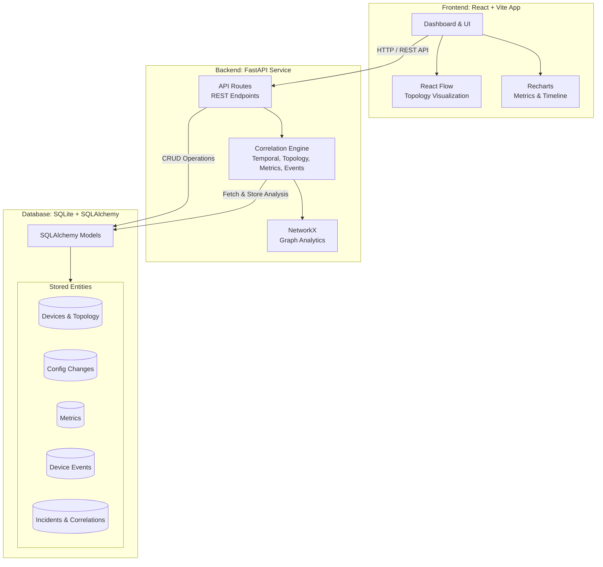

# Network Correlation System Architecture

This document outlines the high-level architecture of the Intelligent Network Change Impact and Incident Correlation System.

## Architecture Diagram

## Component Breakdown

### 1. Frontend (Client-side)
*   **Framework**: React (with TypeScript), built using Vite for fast bundling.
*   **Styling**: Tailwind CSS for responsive and modern UI components.
*   **Visualizations**: 
    *   **React Flow** is used to render interactive network topologies.
    *   **Recharts** is used to display historical metrics (latency, packet loss) and timelines.
*   **Pages/Views**: Dashboard, Incident Investigation, Metrics, and Topology.

### 2. Backend (Server-side)
*   **Framework**: Python with FastAPI for high-performance RESTful APIs.
*   **Correlation Engine**: The core logic (`engine.py`) that analyzes incidents by examining:
    *   **Temporal Proximity**: Configuration changes happening close to the incident.
    *   **Topology Impact**: Whether the changed device is upstream or connected.
    *   **Metrics Degradation**: Spikes in latency or packet loss following a change.
    *   **Event Analysis**: System events (e.g., OSPF neighbor drops) triggered by the change.
*   **Graph Processing**: `NetworkX` is used to build and traverse the topology graph in memory.

### 3. Database (Storage)
*   **Database**: SQLite (designed with SQLAlchemy ORM, making it easily transferable to PostgreSQL for production).
*   **Key Models**: Devices, Configuration Changes, Device Events, Metrics, Topology Links, Incidents, Correlations, and Recommendations.

## Data Flow for Incident Correlation

1.  A network **Incident** is logged in the system.
2.  The frontend requests an analysis from the backend API.
3.  The **Correlation Engine** queries the database for recent **Configuration Changes** on network devices.
4.  The Engine cross-references these changes with the **Topology** (via NetworkX), subsequent **Metrics**, and **Events**.
5.  Scores are calculated for each factor, and an aggregated **Correlation Score** with a human-readable **Explanation** and **Recommendation** is generated and saved.
6.  The frontend retrieves this analysis and renders the timeline, graph, and actionable insights to the network administrator.
